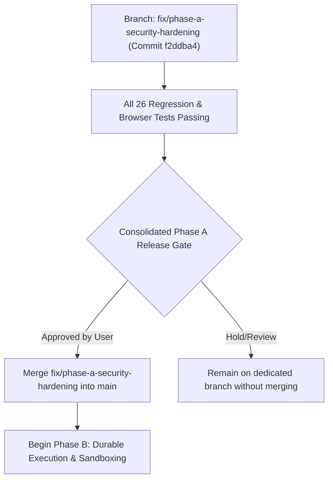

# Phase A Security Hardening: Consolidated Review & Release Gate Report

**Target Branch:** `fix/phase-a-security-hardening`  
**Current HEAD Commit:** [`f2ddba408b0fe6216943673701d9b475523882ac`](file:///home/gamp/portfolio/ai-cloud-workspace/db.py)  
**Baseline Commit (`main`):** `871e7e2803fc185469900e009c44406c16211358` (10 commits ahead, 0 behind)  
**PR #1 (`origin/audit/engineering-hardening-plan`):** Untouched at `0881b6a`  

---

## 1. Executive Summary

Phase A security hardening has remediated all identified vulnerabilities across authentication, credential isolation, secret storage, command execution, path confinement, and execution truthfulness.

A full test suite run passes with **26 passed tests** (25 unit/security regression tests + 1 end-to-end Playwright browser integration test).

The branch remains completely isolated on `fix/phase-a-security-hardening` and is ready for final authorization prior to merging into `main` and beginning Phase B (Durable Execution).

---

## 2. Comprehensive Security Boundary Audit

| # | Security Domain | Baseline Vulnerability (`main`) | Hardened Implementation (`fix/phase-a-security-hardening`) | Automated Test Verification |
|---|---|---|---|---|
| **1** | **OAuth / PKCE Session Binding** | Static PKCE verifier, single-state fallback if unsupplied, unbound to browser session. | Dynamic cryptographic PKCE verifiers (`secrets.token_urlsafe(64)`), strict single-use state consumption, session ID bound to browser cookie (`ai_cloud_ws_sid`). Rejects missing/empty session IDs and cross-session replays. | [`test_pkce_verifiers_and_states_are_unique_and_unpredictable`](file:///home/gamp/portfolio/ai-cloud-workspace/tests/test_phase_a_security.py#L65)<br>[`test_oauth_exchange_rejects_cross_session_state`](file:///home/gamp/portfolio/ai-cloud-workspace/tests/test_phase_a_security.py#L74)<br>[`test_oauth_exchange_rejects_invalid_state_even_when_single_pending_state_exists`](file:///home/gamp/portfolio/ai-cloud-workspace/tests/test_phase_a_security.py#L138)<br>[`test_oauth_exchange_single_use_prevents_replay`](file:///home/gamp/portfolio/ai-cloud-workspace/tests/test_phase_a_security.py#L167) |
| **2** | **OAuth State Store Fail-Closed & Preservation** | State file corruption or parse errors silently overwrote file with `{}`. | Atomic modify (`fcntl.flock(LOCK_EX)`) fails closed. Raises `OAuthStateStorageError` on empty, whitespace-only, malformed JSON, non-dict objects, `OSError` (permissions), and `UnicodeDecodeError` (invalid UTF-8). Original file on disk is preserved untouched. | [`test_corrupted_oauth_states_file_fails_closed_and_preserves_file`](file:///home/gamp/portfolio/ai-cloud-workspace/tests/test_phase_a_security.py#L211) |
| **3** | **Fail-Closed Encryption & Local Storage** | Plaintext fallback if `ENCRYPTION_KEY` was missing; silent empty dictionary `{}` return if stored ciphertext was corrupted. | `encrypt_secret` and `_save_local_user_data` raise `EncryptionConfigurationError` if key is missing. `_load_local_user_data` raises `DecryptionError` on corrupted ciphertext while distinguishing legitimate legacy plaintext JSON. | [`test_encrypt_secret_fails_closed_when_key_missing`](file:///home/gamp/portfolio/ai-cloud-workspace/tests/test_phase_a_security.py#L299)<br>[`test_save_local_user_data_fails_closed_when_key_missing`](file:///home/gamp/portfolio/ai-cloud-workspace/tests/test_phase_a_security.py#L306)<br>[`test_load_local_user_data_distinguishes_legacy_and_raises_on_corrupted_ciphertext`](file:///home/gamp/portfolio/ai-cloud-workspace/tests/test_phase_a_security.py#L313)<br>[`test_decrypt_secret_fails_closed_on_invalid_token`](file:///home/gamp/portfolio/ai-cloud-workspace/tests/test_phase_a_security.py#L338) |
| **4** | **Credential Isolation & Redaction** | GitHub tokens passed via command-line URLs (`https://{token}@github.com/...`) visible in process table `/proc` and logs. | Custom `GIT_ASKPASS` helper (`.git_askpass_*`) dynamically written with permissions `0700` and cleaned up in a `finally` block even if Git commands exit with error. Regex token sanitization in error messages. | [`test_clone_does_not_embed_token_in_url_or_command_args`](file:///home/gamp/portfolio/ai-cloud-workspace/tests/test_phase_a_security.py#L363)<br>[`test_askpass_cleans_up_even_if_git_command_fails`](file:///home/gamp/portfolio/ai-cloud-workspace/tests/test_phase_a_security.py#L383)<br>[`test_sanitize_error_message_redacts_tokens`](file:///home/gamp/portfolio/ai-cloud-workspace/tests/test_phase_a_security.py#L354) |
| **5** | **Path Confinement & Symlink Escapes** | Weak path concatenation allowed traversal outside workspace and symlink dereference escapes. | Prefix-aware boundary checks (`/home/user/workspace/` with trailing slash), rejecting traversal attempts (`../`). Read and write operations validate canonical target path via `realpath -m`; fails closed if target resolves outside workspace or if `realpath` fails/returns empty. | [`test_resolve_path_blocks_directory_traversal`](file:///home/gamp/portfolio/ai-cloud-workspace/tests/test_phase_a_security.py#L609)<br>[`test_read_and_write_file_reject_symlink_escapes`](file:///home/gamp/portfolio/ai-cloud-workspace/tests/test_phase_a_security.py#L643)<br>[`test_read_and_write_file_fail_closed_if_realpath_fails_or_returns_empty`](file:///home/gamp/portfolio/ai-cloud-workspace/tests/test_phase_a_security.py#L663) |
| **6** | **Command Injection Defense** | Unsanitized branch names and commit messages passed into shell commands. | Strict branch name validation against alphanumeric/safe character regex `^[a-zA-Z0-9_\-\./]+$`. Reject dashes as prefix. Commit messages and arguments escaped using `shlex.quote`. | [`test_malicious_branch_names_rejected`](file:///home/gamp/portfolio/ai-cloud-workspace/tests/test_phase_a_security.py#L425)<br>[`test_commit_message_with_shell_characters_is_safely_escaped`](file:///home/gamp/portfolio/ai-cloud-workspace/tests/test_phase_a_security.py#L449) |
| **7** | **Truthful Execution Outcomes** | Commands returning non-zero exit codes were masked or reported as successful tasks. | Sandbox command execution inspects `exit_code != 0` and explicitly marks execution status as failed. Step limit exhaustion in agent loop reported as incomplete with truthful error message. | [`test_nonzero_exit_code_is_reported_as_failure`](file:///home/gamp/portfolio/ai-cloud-workspace/tests/test_phase_a_security.py#L484)<br>[`test_step_limit_exhaustion_is_reported_as_incomplete`](file:///home/gamp/portfolio/ai-cloud-workspace/tests/test_phase_a_security.py#L508) |

---

## 3. Browser OAuth Redirect Lifecycle Verification

End-to-end integration test [`tests/test_browser_oauth_redirect.py`](file:///home/gamp/portfolio/ai-cloud-workspace/tests/test_browser_oauth_redirect.py) launches a dedicated headless Chromium browser against an active Streamlit server instance and verifies:
1. **Cookie Generation**: Browser receives `ai_cloud_ws_sid` cookie with `SameSite=Lax`, `Path=/`, and conditional `Secure` flag.
2. **Persistence across Full Redirect**: Simulates navigation away to external identity provider (GitHub) and full redirect back to `/?code=mock_code&state=mock_state`.
3. **Session Cookie Recovery**: Verifies Streamlit request context reads cookie and matches the initiating session ID.
4. **State Consumption on Match**: Authenticated session consumes the state and transitions to dashboard view (`Dashboard / Workspace`).
5. **Rejection on Foreign Session**: Secondary browser context attempting to replay the same callback query parameters is rejected, and pending state is preserved.

---

## 4. Full Test Results

Execution command:
```bash
PYTHONPATH=. .venv/bin/pytest tests/test_phase_a_security.py tests/test_browser_oauth_redirect.py -v
```

Outcome:
```text
============================= test session starts ==============================
collected 26 items

tests/test_phase_a_security.py::TestOAuthSecurity::test_pkce_verifiers_and_states_are_unique_and_unpredictable PASSED [  3%]
tests/test_phase_a_security.py::TestOAuthSecurity::test_oauth_exchange_rejects_cross_session_state PASSED [  7%]
tests/test_phase_a_security.py::TestOAuthSecurity::test_oauth_flow_survives_browser_redirect_with_cookie_storage PASSED [ 11%]
tests/test_phase_a_security.py::TestOAuthSecurity::test_oauth_exchange_rejects_invalid_state_even_when_single_pending_state_exists PASSED [ 15%]
tests/test_phase_a_security.py::TestOAuthSecurity::test_oauth_exchange_single_use_prevents_replay PASSED [ 19%]
tests/test_phase_a_security.py::TestOAuthSecurity::test_oauth_states_expire PASSED [ 23%]
tests/test_phase_a_security.py::TestOAuthSecurity::test_corrupted_oauth_states_file_fails_closed_and_preserves_file PASSED [ 26%]
tests/test_phase_a_security.py::TestFailClosedEncryption::test_encrypt_secret_fails_closed_when_key_missing PASSED [ 30%]
tests/test_phase_a_security.py::TestFailClosedEncryption::test_save_local_user_data_fails_closed_when_key_missing PASSED [ 34%]
tests/test_phase_a_security.py::TestFailClosedEncryption::test_load_local_user_data_distinguishes_legacy_and_raises_on_corrupted_ciphertext PASSED [ 38%]
tests/test_phase_a_security.py::TestFailClosedEncryption::test_load_local_user_data_supports_legitimate_legacy_plaintext_json PASSED [ 42%]
tests/test_phase_a_security.py::TestFailClosedEncryption::test_decrypt_secret_fails_closed_on_invalid_token PASSED [ 46%]
tests/test_phase_a_security.py::TestFailClosedEncryption::test_save_user_api_key_fails_closed_when_key_missing PASSED [ 50%]
tests/test_phase_a_security.py::TestFailClosedEncryption::test_valid_encryption_roundtrip PASSED [ 53%]
tests/test_phase_a_security.py::TestTokenIsolationAndRedaction::test_sanitize_error_message_redacts_tokens PASSED [ 57%]
tests/test_phase_a_security.py::TestTokenIsolationAndRedaction::test_clone_does_not_embed_token_in_url_or_command_args PASSED [ 61%]
tests/test_phase_a_security.py::TestTokenIsolationAndRedaction::test_askpass_cleans_up_even_if_git_command_fails PASSED [ 65%]
tests/test_phase_a_security.py::TestSafeGitCommandConstruction::test_malicious_branch_names_rejected PASSED [ 69%]
tests/test_phase_a_security.py::TestSafeGitCommandConstruction::test_commit_message_with_shell_characters_is_safely_escaped PASSED [ 73%]
tests/test_phase_a_security.py::TestTruthfulOutcomes::test_nonzero_exit_code_is_reported_as_failure PASSED [ 76%]
tests/test_phase_a_security.py::TestTruthfulOutcomes::test_step_limit_exhaustion_is_reported_as_incomplete PASSED [ 80%]
tests/test_phase_a_security.py::TestPathConfinementAndSymlinks::test_resolve_path_blocks_directory_traversal PASSED [ 84%]
tests/test_phase_a_security.py::TestPathConfinementAndSymlinks::test_resolve_path_allows_legitimate_subpaths PASSED [ 88%]
tests/test_phase_a_security.py::TestPathConfinementAndSymlinks::test_read_and_write_file_reject_symlink_escapes PASSED [ 92%]
tests/test_phase_a_security.py::TestPathConfinementAndSymlinks::test_read_and_write_file_fail_closed_if_realpath_fails_or_returns_empty PASSED [ 96%]
tests/test_browser_oauth_redirect.py::TestBrowserOAuthRedirectLifecycle::test_browser_creates_and_preserves_cookie_across_full_redirect PASSED [100%]

============================= 26 passed in 33.62s ==============================
```

---

## 5. Release Gate & Next Steps



> [!IMPORTANT]
> The repository remains strictly on `fix/phase-a-security-hardening`.
> Baseline `main` (`871e7e2803fc185469900e009c44406c16211358`) and PR #1 remain untouched.
> Phase B has not been started.
