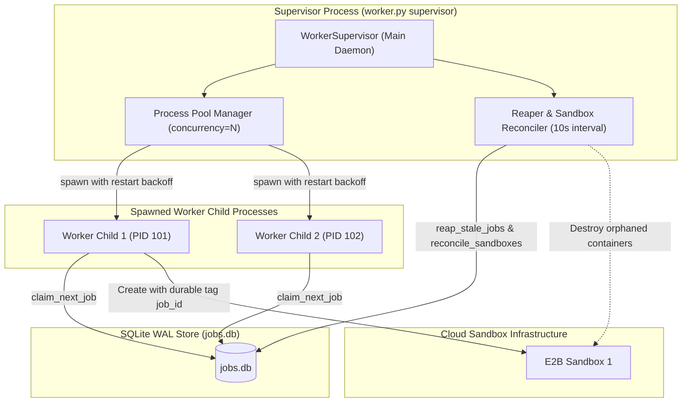

# Phase B.2 — Autonomous Worker Engine: Consolidated Architecture Specification & Engineering Contract

**Repository:** `laxjovial/ai-cloud-workspace`  
**Working Branch:** `feat/phase-b-durable-execution`  
**Specification Revision:** 2.0 (Post-Review Hardening)  
**Baseline (`main`):** `5147be6c127c3eed87b6cabb0ca24f65b2550fa7` (strictly untouched)  
**Scope Boundary:** Phase B.2 covers only the background worker engine, process supervisor, heartbeat/fencing watchdog, crash-resilient sandbox registry/reconciler, and associated tests. It introduces **no Streamlit changes (`app.py` untouched)** and **no Phase C work**.

---

## 1. Process Supervision, Concurrency, & Worker Lifecycle



### 1.1 Process Supervision & Crash-Loop Protection
- **Process Model**:
  The supervisor launches a fixed pool of $N$ worker processes using `multiprocessing.get_context("spawn")`. This prevents shared memory corruption, file-descriptor leaks, and deadlocks across parent/child boundaries.
- **Child Crash & Crash-Loop Protection**:
  1. The supervisor monitors child PIDs using `process.is_alive()` and non-blocking `os.waitpid(-1, os.WNOHANG)`.
  2. If a child terminates unexpectedly (exit code $\neq 0$, OOM, segfault):
     - The supervisor logs the crash event with PID and exit status.
     - **Crash-Loop Backoff**: If a worker crashes within 10 seconds of launch, the supervisor increments a crash counter for that slot and applies exponential backoff: $1s \to 2s \to 4s \to 8s \to \dots \to 30s$ max.
     - If a worker crashes 5 consecutive times without successfully executing any work, the slot pauses and raises a critical supervisor telemetry event.
- **Supervisor Self-Recovery & Restart**:
  When the supervisor itself starts or restarts:
  1. It connects to `jobs.db` and immediately runs a **Startup Reconciliation Pass**:
     - Scans `jobs` for `status = 'RUNNING'`.
     - Expired leases are immediately processed by the reconciler.
     - Orphaned sandbox IDs are reconciled and queued for destruction.
  2. Once the database is in a clean state, it boots the child worker pool.
- **Clean Deployment Shutdown (`SIGTERM` / `SIGINT`)**:
  - A deployment shutdown or supervisor termination is **not** a user cancellation.
  - The supervisor sets an internal `shutdown_event` and sends `SIGTERM` to worker processes.
  - Workers cease polling for new jobs. Running jobs are given a **15-second grace period** to checkpoint in-flight work and cleanly pause or fail gracefully with `status = 'RECOVERABLE'` (allowing another worker to resume after restart), without falsely marking the job `CANCELLED`.
  - After 15 seconds, remaining uncooperative children receive `SIGKILL`, and their sandboxes are reconciled.

---

## 2. Dedicated Sandbox Registration & Cleanup Schema (B.1 Migration 2)

To eliminate the state machine violation (transitioning `RUNNING \to RUNNING`) and track sandbox cleanup durably across all failure paths, Phase B.2 introduces **Migration 2** in `job_queue.py`:

### 2.1 Database Schema Migration
```sql
-- Migration 2: Dedicated Sandbox Registration, Side-Effect Intents, and Cleanup Lifecycle
ALTER TABLE jobs ADD COLUMN sandbox_cleanup_status TEXT DEFAULT 'NONE'; -- 'NONE', 'CLEANED', 'FAILED', 'ORPHANED'
ALTER TABLE jobs ADD COLUMN sandbox_cleanup_attempts INTEGER DEFAULT 0;
ALTER TABLE jobs ADD COLUMN sandbox_cleanup_error TEXT;
ALTER TABLE jobs ADD COLUMN sandbox_cleanup_next_retry REAL;
ALTER TABLE jobs ADD COLUMN side_effect_intents_json TEXT DEFAULT '{}';
```

### 2.2 Dedicated Fenced API: `register_sandbox()`
Rather than modifying status, `job_queue.py` adds an atomic, fenced registration method:
```python
def register_sandbox(
    self,
    job_id: str,
    sandbox_id: str,
    worker_id: str,
    lease_generation: int,
) -> bool:
    """Atomically registers an active sandbox container ID.
    
    Invariants:
    1. Validates status == 'RUNNING', worker_id == expected, lease_generation == expected.
    2. Validates lease_expires_at IS NOT NULL AND lease_expires_at >= now.
    3. Idempotent: If sandbox_id already matches, returns True without error.
    4. If another conflicting sandbox_id is already registered for this generation, raises JobQueueError.
    """
```

### 2.3 Sandbox Cleanup Lifecycle & The Pre-Claim Invariant
- **The Pre-Claim Invariant**:
  A reaped job whose lease expired **must never be claimed by another worker until its previous cloud sandbox is confirmed destroyed (or confirmed absent)**.
- **Reconciliation State Machine**:
  1. When `reap_stale_jobs()` runs, it returns structured records:
     ```python
     [
         {
             "job_id": "...",
             "sandbox_id": "...",
             "lease_generation": 1,
             "status": "RUNNING",
             "cancel_requested": False
         }
     ]
     ```
  2. If `sandbox_id` is present, the job transitions to `status = 'RECOVERABLE'` with `sandbox_cleanup_status = 'ORPHANED'`. It is **not** set to `QUEUED` yet.
  3. The reconciler issues an E2B API call (`Sandbox.kill(sandbox_id)` or `Sandbox.connect(sandbox_id).kill()`) with a **5.0-second bounded timeout**:
     - **Success**: Reconciler calls `mark_sandbox_cleaned(job_id)`. The job is then transitioned to `QUEUED` (or `CANCELLED` if cancellation was pending).
     - **Failure (Network/Rate-Limit/Timeout)**: Reconciler records `sandbox_cleanup_status = 'FAILED'`, increments `sandbox_cleanup_attempts`, sets exponential backoff in `sandbox_cleanup_next_retry`, and leaves the job unclaimable.
     - **Persistent Failure Escalation**: If cleanup fails 10 times consecutively, the job transitions to terminal `FAILED` with an alert logged to `job_events`, preventing infinite claim loops while keeping cloud billing bounded.

### 2.4 Race-Window Mitigation: Creation Without Registration
If a worker creates an E2B sandbox but crashes before calling `register_sandbox()`:
- When creating containers, `WorkspaceSandbox` adds a cloud metadata tag: `tags={"managed_by": "ai-cloud-workspace", "job_id": job_id}`.
- Every 60 seconds, the supervisor's Orphan Discovery scanner queries the provider's active sandboxes via `Sandbox.list()`. Any sandbox whose tagged `job_id` is terminal, missing from DB, or whose lease has expired without matching `sandbox_id` is automatically terminated.

---

## 3. Worker Heartbeat, Cancellation Polling, & Self-Fencing

### 3.1 Bounded Interruption & Two-Thread Worker Architecture
Inside each worker process:
1. **Execution Thread**:
   - Executes `agent.run_agent_turn()` step by step.
   - Uses `time.monotonic()` for all in-process elapsed time tracking (immune to NTP steps or system clock adjustments).
   - Before invoking LiteLLM and before executing each tool, checks `abort_event.is_set()`.
2. **Heartbeat & Watchdog Thread**:
   - Executes every 5 seconds.
   - Calls the atomic queue method: `poll_worker_status(job_id, worker_id, lease_generation, lease_duration=30.0)`.

### 3.2 Atomic Method: `poll_worker_status()`
This method combines lease extension and cancellation inspection into a single transaction:
```python
def poll_worker_status(
    self,
    job_id: str,
    worker_id: str,
    lease_generation: int,
    lease_duration_seconds: float = DEFAULT_LEASE_DURATION_SECONDS,
) -> str:
    """Atomically validates lease, renews expiration, and inspects cancellation state.
    
    Returns:
    - 'ACTIVE': Lease extended, job is running normally.
    - 'CANCEL_REQUESTED': Lease extended, user requested cancellation.
    - 'STALE': Worker lease expired or was superseded (Worker must self-fence immediately).
    """
```

### 3.3 Strict Self-Fencing on Stale Lease
If `poll_worker_status` returns `'STALE'` (or raises `StaleLeaseError`), or if the database is unreachable:
1. Heartbeat thread immediately trips `abort_event.set()`.
2. **Self-Fencing Guard**: The execution thread halts immediately. **It does not execute the pending tool call and does not attempt any further database updates.**
3. The worker issues a bounded kill to its local sandbox handle and exits cleanly.

---

## 4. Idempotency & Side-Effect Reconciliation Protocol

To prevent duplicate side effects (e.g. duplicate GitHub PRs, duplicate branch pushes) under at-least-once execution semantics:

### 4.1 Side-Effect Identity & Intent Table
Every external action with irreversible side effects is assigned a deterministic identity:
`side_effect_id = sha256(f"{job_id}:{tool_name}:{action_key}")[:16]`

Before invoking the external provider:
1. **Record Intent**:
   ```python
   job_queue.record_side_effect_intent(job_id, worker_id, gen, side_effect_id, "PENDING", details)
   ```
2. **Reconcile Prior to Execution**:
   - **For PR Creation**:
     The worker queries the GitHub repository via PyGithub:
     `repo.get_pulls(state="open", head=f"{repo.owner.login}:{branch_name}")`
     If an existing PR matches the target branch and title:
     - Worker re-attaches to the existing PR URL and number.
     - Updates intent state to `CONFIRMED`.
     - Logs: `"Reconciled existing remote Pull Request #{pr.number}; skipping duplicate creation."`
   - **For Branch Pushes**:
     Branch names are strictly deterministically derived: `ai-cloud/job-{job_id[:8]}`.
     If a user specifies a custom branch name, it is scoped as: `ai-cloud/{user_id[:6]}-{custom_branch_name}` to prevent cross-job and cross-tenant branch collisions.
3. **Record Confirmed Result**:
   Upon provider return, records intent state as `CONFIRMED` with the external URL/ID in `side_effect_intents_json`.

---

## 5. Bounded Interruption & Cancellation Protocol

### 5.1 Two-Tier Cancellation Escalation
```mermaid
sequenceDiagram
    participant User as Streamlit User
    participant DB as jobs.db
    participant Sup as WorkerSupervisor
    participant HB as Worker Watchdog Thread
    participant Main as Worker Execution Thread
    participant E2B as Cloud Sandbox

    User->>DB: request_cancellation(job_id)
    Note over DB: cancel_requested_at set
    
    par Tier 1: Cooperative (0 to 15s)
        HB->>DB: poll_worker_status()
        DB-->>HB: 'CANCEL_REQUESTED'
        HB->>Main: abort_event.set()
        Main->>E2B: close sandbox (5s timeout)
        Main->>DB: update_job_status('CANCELLED')
    and Tier 2: Forced Escalation (after 15s)
        Sup->>DB: Check in-flight cancelled jobs > 15s
        Note over Sup: Worker hung; escalate to SIGKILL
        Sup->>Main: send SIGKILL
        Sup->>E2B: Sandbox.kill(sandbox_id)
        Sup->>DB: update_job_status('CANCELLED')
    end
```

1. **Cooperative Window (0 to 15 seconds)**:
   - Worker detects `CANCEL_REQUESTED` via `poll_worker_status()`.
   - Halts execution before next tool.
   - Calls `sandbox.close()` with a bounded timeout of 5 seconds.
   - Calls `job_queue.update_job_status(job_id, "CANCELLED", worker_id, gen)`.
2. **Forced Escalation (15+ seconds)**:
   - The supervisor's reconciler scans for jobs where `cancel_requested_at IS NOT NULL` and `now - cancel_requested_at > 15.0`.
   - Supervisor identifies the worker process PID and sends `SIGTERM`, followed 5 seconds later by `SIGKILL`.
   - The supervisor reconciler independently kills the sandbox and sets status to `CANCELLED`.

### 5.2 Monotonic Wall-Clock Timeout Enforcement
- Process execution duration is measured via `time.monotonic()`.
- If `time.monotonic() - started_monotonic > timeout_seconds`:
  1. Watchdog sets `abort_event`.
  2. Issues bounded `sandbox.close()` (5s timeout).
  3. Records `TIMED_OUT` with structured diagnostics.
  4. B.1's precedence policy guarantees that if cancellation was also requested, status becomes `CANCELLED` while preserving the timeout diagnostic error.

---

## 6. Spawned Worker Credential Resolution

- **No Secrets in Payloads or Process Arguments**:
  Job payloads contain only credential references: `{"github": {"key_ref": "user_github_pat"}}`.
- **Worker-Context Resolution**:
  When a spawned child worker begins a job:
  1. It reads the user's encrypted local store: `~/.ai_cloud_workspace/.user_store/<safe_user_id>.json`.
  2. It initializes `Fernet` in memory using `ENCRYPTION_KEY` (from environment or worker configuration).
  3. It decrypts only the specific keys referenced by `credential_refs` directly into local Python memory.
  4. Tokens are passed to `WorkspaceSandbox` in-memory. They are **never passed as CLI flags, logged to stdout/stderr, or recorded in `job_events`**.
  5. The askpass helper in `sandbox.py` continues to isolate credentials from Git command arguments and logs.

---

## 7. Comprehensive Failure-Injection Test Plan for Phase B.2

Dedicated test file: `tests/test_phase_b_worker_engine.py`

| # | Test Scenario | Injection / Failure Condition | Verification Invariant |
|---|---|---|---|
| **1** | **Normal Worker Turn** | Standard multi-step agent turn. | Job completes, logs stream, sandbox destroyed, terminal status `COMPLETED`. |
| **2** | **Heartbeat Maintenance** | Long-running task (10s) with 3s lease. | Heartbeat continuously extends lease; job never expires. |
| **3** | **Pre-Step Self-Fencing** | Worker lease expires mid-run; heartbeat returns `'STALE'`. | Worker halts immediately; **zero** subsequent tool calls made; sandbox destroyed. |
| **4** | **Cooperative Cancellation** | User requests cancellation during turn 1 of 3. | Worker detects `CANCEL_REQUESTED`, halts before turn 2, destroys sandbox, records `CANCELLED`. |
| **5** | **Forced Cancellation Escalation** | Mock tool hangs indefinitely after cancel requested. | Supervisor triggers `SIGTERM`/`SIGKILL` at 15s; reconciler destroys sandbox, marks `CANCELLED`. |
| **6** | **Monotonic Timeout Interruption** | Mock command exceeds `timeout_seconds`. | Watchdog halts execution, terminates container, records `TIMED_OUT`. |
| **7** | **Crash & Re-Claim Pre-Condition** | Worker killed via `SIGKILL` while holding active sandbox. | Stale job is **not** re-queued until reconciler confirms old sandbox destroyed. |
| **8** | **Sandbox Creation Race Window** | Worker killed immediately after sandbox create, before DB registration. | Orphan scanner discovers tagged container in cloud provider list and destroys it. |
| **9** | **Cleanup API Failure & Retry** | Reconciler encounters simulated 500 error calling `Sandbox.kill()`. | Job transitions to `ORPHANED` / `FAILED` cleanup; retries with exponential backoff; not re-queued. |
| **10** | **PR Idempotency on Worker Retry** | Worker creates PR on GitHub, then crashes before DB write. Next worker retries job. | Worker inspects remote PRs, re-attaches to existing PR, avoids creating duplicate. |
| **11** | **Supervisor Crash-Loop Protection** | Child worker process repeatedly crashes on startup. | Supervisor applies exponential backoff ($1s \to 30s$); prevents fork bomb. |
| **12** | **Spawned Worker Credential Isolation** | Inspect child process `/proc/<pid>/cmdline`, environment, and `job_events`. | Zero plaintext GitHub tokens or LLM API keys leaked across IPC boundaries. |

---

## 8. Verification Gate & Commit Evidence

- **Current HEAD**: `a287ad20036c7b38c562ffb8dbeb996cc0016255`
- **Main Baseline**: `5147be6c127c3eed87b6cabb0ca24f65b2550fa7` (strictly untouched)
- **Scope Commitment**: `app.py` remains untouched. Phase B.2 implementation will not start until this specification is authorized.
