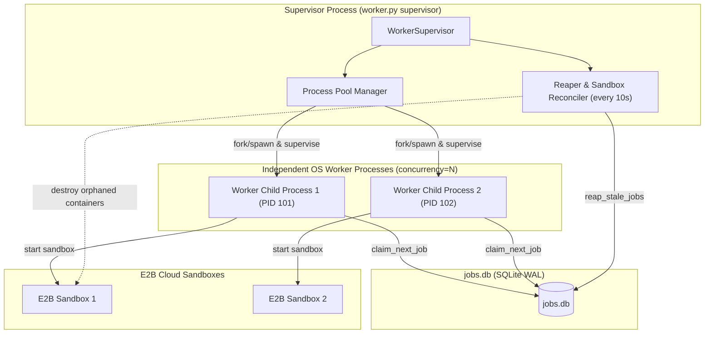

# Phase B.2 — Autonomous Worker Engine: Architecture Specification & Engineering Contract

**Repository:** `laxjovial/ai-cloud-workspace`  
**Working Branch:** `feat/phase-b-durable-execution`  
**Current HEAD Commit:** `1c8ca7dffd9830efaf36ad01fc2633bffb6b427c`  
**Baseline (`main`):** `5147be6c127c3eed87b6cabb0ca24f65b2550fa7` (strictly untouched)  
**Scope Boundary:** Phase B.2 covers only the background worker process, process supervisor, heartbeat/fencing watchdog, crash-resilient sandbox registry/reconciler, and associated tests. It introduces **no Streamlit changes (`app.py` untouched)** and **no Phase C work**.

---

## 1. Process Supervision & Concurrency Control



### 1.1 Supervision Contracts
- **Worker Invocation**:
  The supervisor starts a fixed pool of $N$ worker processes (configured via `--concurrency N`, default: 2).
  Workers are independent OS processes using `multiprocessing.get_context("spawn")` to guarantee clean memory isolation and prevent accidental file-descriptor or lock sharing.
- **Hung Worker Detection**:
  The supervisor does not guess whether a process is hung based on execution time alone. Instead:
  1. The worker process must continuously update its heartbeat in `jobs.db`.
  2. If a worker's child process terminates unexpectedly (crashes, segfaults, OOM, exit code $\neq 0$), the supervisor detects child termination in its event loop via `process.is_alive()` or `SIGCHLD`.
  3. The supervisor logs the crash, spawns a fresh worker replacement to preserve concurrency, and allows the **Reaper & Reconciler** to handle the dead worker's leased job.
- **Graceful Shutdown (`SIGINT` / `SIGTERM`)**:
  When the supervisor receives a termination signal:
  1. It signals all child worker processes to cease claiming new jobs.
  2. Running workers receive a cooperative shutdown event (`cancel_requested_at` or `SIGTERM`).
  3. Workers are given a 15-second grace period to cleanly stop running tools, close sandboxes, and finalize state.
  4. Any worker still alive after the grace period is forcibly terminated via `SIGKILL`, and its sandbox is handed off to the cleanup reconciler.

---

## 2. Heartbeat, Monotonic Fencing, & Execution Guarding

### 2.1 The Two-Thread Execution Model inside each Worker Process
Inside each child worker process:
- **Main Worker Thread**: Polls `claim_next_job()`, manages credential resolution in memory, and steps through `agent.run_agent_turn()`.
- **Heartbeat & Watchdog Thread**: Runs every 5 seconds while a job is active.

```mermaid
sequenceDiagram
    participant Main as Worker Main Thread
    participant HB as Worker Heartbeat Thread
    participant DB as jobs.db (SQLite WAL)
    participant E2B as E2B Cloud Sandbox

    Main->>DB: claim_next_job(worker_id)
    DB-->>Main: Returns job (gen 1, lease_expires_at)
    Main->>E2B: start sandbox (obtain sandbox_id)
    Main->>DB: update sandbox_id
    Main->>HB: start_heartbeat(job_id, gen 1)
    
    loop Every 5 seconds
        HB->>DB: record_heartbeat(job_id, worker_id, gen 1)
        DB-->>HB: Success (lease extended)
    end

    Note over Main,DB: Network stalls; heartbeat fails or lease expires
    HB->>DB: record_heartbeat(job_id, worker_id, gen 1)
    DB-->>HB: StaleLeaseError (superseded or expired)
    HB->>Main: Sets emergency stop event (abort_event.set())
    Main->>E2B: Immediately kill sandbox
    Main->>Main: Abort execution turn; refuse further DB writes
```

### 2.2 Strict Invariants
1. **Pre-Step Validation**:
   Before invoking each agent step, and before each tool call (`run_terminal_command`, `read_file`, `write_file`, `create_pull_request`), the execution thread checks:
   - `abort_event.is_set()` (tripped if heartbeat thread encountered `StaleLeaseError` or timeout).
   - If set: Execution is aborted immediately. **No tool call is made, no further logs are written, and the sandbox is destroyed.**
2. **Re-Revival Rejection**:
   As proven in B.1 tests, `job_queue.py` strictly rejects `record_heartbeat`, `append_log`, and `update_job_status` if `lease_expires_at < now`. A worker cannot revive its lease after expiration.

---

## 3. Crash-Resilient Sandbox Tracking & Reconciliation

A Python `finally: sandbox.close()` block **cannot execute** during `SIGKILL`, worker segfault, or host power loss. To ensure cloud sandboxes never leak:

### 3.1 Durable Sandbox Registration
- Immediately upon `sandbox.start()` returning success, `worker.py` invokes:
  ```python
  job_queue.update_job_status(job_id, "RUNNING", worker_id, gen, sandbox_id=sandbox.id)
  ```
- The cloud container ID is durably recorded in `jobs.db` before any command or tool execution takes place.

### 3.2 The Supervisor Sandbox Reconciler
- Every 10 seconds, the supervisor's `Reaper & Reconciler` runs:
  1. Calls `reap_stale_jobs()` in `job_queue.py` to identify jobs whose lease expired or were cancelled.
  2. For every reaped job with a non-null `sandbox_id`:
     - Calls E2B's API: `Sandbox.connect(sandbox_id).kill()` or `Sandbox.kill(sandbox_id)`.
     - Records a `SANDBOX_DESTROYED` event in `job_events`.
     - Sets `sandbox_id = NULL` on the job row once destroyed.
  3. **Cleanup Failure & Retry Policy**:
     - If the E2B API call fails (network timeout, rate limit, provider error):
       - The error is logged into `job_events`.
       - The job row retains `sandbox_id` and sets `sandbox_cleanup_failed = 1`.
       - The reconciler retries destruction on subsequent iterations with exponential backoff up to 10 attempts before escalating to an alert log.
       - A stale job is **never re-queued** to a new worker until its previous sandbox has been confirmed destroyed.

---

## 4. Idempotency & Safe At-Least-Once Execution

Autonomous software agents execute irreversible external actions (e.g. creating GitHub Pull Requests). A worker crash during or immediately after creating a PR must not cause duplicate PRs on retry.

### 4.1 Side-Effect Reconciliation Contracts
- **Pull Request Creation**:
  Before calling `repo.create_pull()`, the agent/worker checks if a PR already exists for the repository matching:
  - `head = branch_name`
  - `base = base_branch`
  - If an existing PR is found:
    - It re-attaches to the existing PR URL and number.
    - Records an event: `"Re-attached to existing Pull Request #{pr_number}"`.
    - Avoids raising an exception or creating duplicate PRs.
- **Git Branch Creation & Push**:
  - The branch name is deterministically derived from the job: `ai-cloud/job-{job_id[:8]}` (unless explicitly overridden).
  - Pushes use `-u origin {branch_name}` with ASKPASS isolation. If the branch already exists remotely, the worker resets to clean state or updates cleanly without conflict.
- **Tool Invocation IDs**:
  - Each tool call records a unique `tool_execution_id` in `job_events` alongside stdout/stderr and exit code.
  - On retry, the agent inspects existing `job_events` to avoid repeating idempotent preparatory steps.

---

## 5. Cancellation & Timeout Escalation Semantics

### 5.1 Cancellation Workflow
1. **User Request**: User clicks cancel in UI (or CLI); `job_queue.request_cancellation(job_id, user_id)` is executed.
2. **Cooperative Acknowledgment**:
   - The worker's heartbeat/watchdog thread detects `cancel_requested_at IS NOT NULL` on its next tick (within 5 seconds).
   - It signals the main execution thread.
   - The main thread stops execution before the next tool call, records final terminal logs, and calls `sandbox.close()`.
   - The worker calls `update_job_status(job_id, "CANCELLED", worker_id, gen)`.
3. **Forced Escalation**:
   - If the worker does not finalize the job within **15 seconds** of `cancel_requested_at`:
     - The supervisor issues `SIGTERM` to the worker process PID.
     - If still alive after 5 more seconds, issues `SIGKILL`.
     - The supervisor reconciler destroys the sandbox and transitions the job to `CANCELLED`.

### 5.2 Wall-Clock Timeout Enforcement
- Jobs define `timeout_seconds` (default: 600s).
- The watchdog thread monitors `time.time() - job["started_at"]`.
- If elapsed time exceeds `timeout_seconds`:
  1. Watchdog sets `abort_event`.
  2. Kills the active sandbox process.
  3. Records `TIMED_OUT` with structured error: `{"reason": "Wall-clock timeout exceeded", "timeout_seconds": 600}`.
  4. (If cancellation was also requested, B.1's precedence policy ensures status is recorded as `CANCELLED` while preserving the timeout diagnostic error).

---

## 6. Verification & Test Plan for Phase B.2

Dedicated test suite: `tests/test_phase_b_worker_engine.py`

| # | Test Scenario | Verification Target |
|---|---|---|
| **1** | **Normal Job Completion** | Worker claims job, executes mock multi-step agent loop, records heartbeats, writes logs, cleans sandbox, transitions to `COMPLETED`. |
| **2** | **Heartbeat & Lease Extension** | Multi-step task running 10s with 5s lease duration maintains continuous heartbeat; lease never expires. |
| **3** | **Worker Self-Fencing on Stale Lease** | Simulate lease expiration / reaper intervention; worker heartbeat receives `StaleLeaseError`; worker immediately aborts and does not execute subsequent steps. |
| **4** | **Cooperative Cancellation** | User requests cancellation during step 2 of 5; worker detects cancellation, halts before step 3, destroys sandbox, records `CANCELLED`. |
| **5** | **Forced Cancellation Escalation** | Worker thread blocked in non-responsive mock; supervisor detects cancellation grace period expired, issues `SIGKILL`, reconciles sandbox, records `CANCELLED`. |
| **6** | **Execution Timeout Watchdog** | Command running longer than `timeout_seconds` is interrupted; worker terminates sandbox and records `TIMED_OUT`. |
| **7** | **Crash Recovery & Orphaned Sandbox Reconciliation** | Worker process killed via `SIGKILL` while holding active sandbox; supervisor reaper detects lease expiration, reads `sandbox_id`, calls `Sandbox.kill()`, and re-queues job safely. |
| **8** | **PR Creation Idempotency** | Retry of a job where PR was already created detects existing remote PR and avoids duplicate PR errors. |
| **9** | **Multi-Worker Concurrency Limit** | Supervisor with `--concurrency 2` runs exactly 2 processes simultaneously; claims 2 jobs concurrently without contention. |
| **10** | **Credential Isolation** | Worker resolves tokens in memory from encrypted store; verifies no raw tokens are written to `jobs.db` or `job_events`. |
