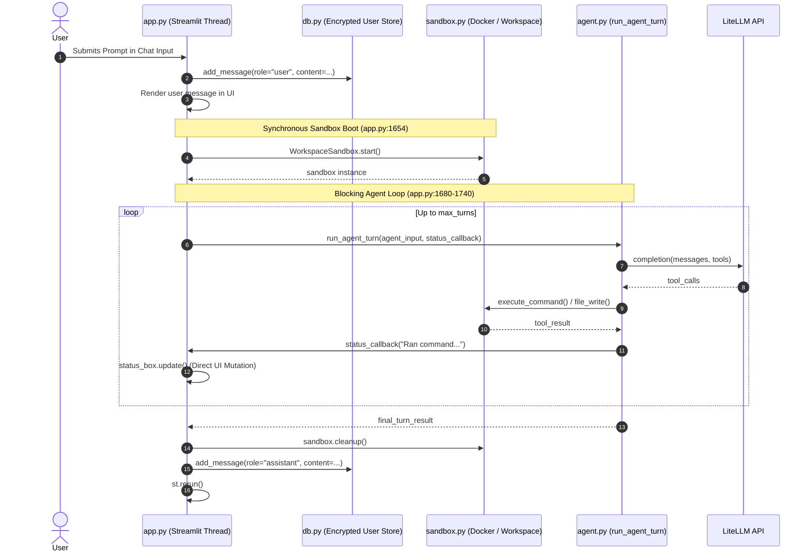
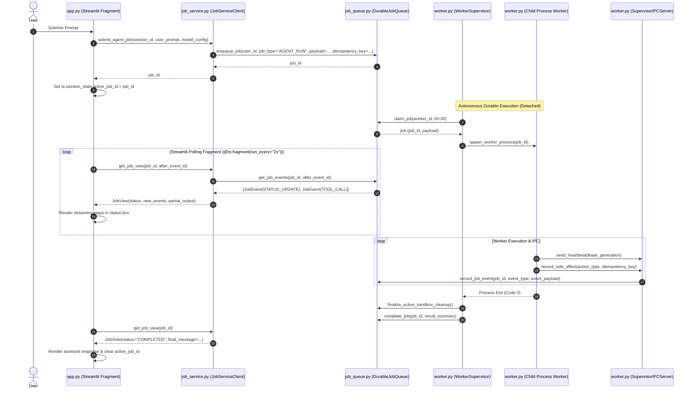

# Phase B.3 Application Integration Architecture Audit & Blueprint

**Status:** Inspection & Design Phase (Pre-Implementation)  
**Author:** AI Cloud Workspace Agent  
**Base Commit Inspected:** [`e02f52b459a72b33691d3ca954aae9654fd59203`](file:///home/gamp/portfolio/ai-cloud-workspace) (`main` post-PR #3 merge)  
**Branch:** `audit/phase-b3-application-integration`  
**Scope:** Streamlit Application (`app.py`), Agent Execution (`agent.py`), User Store (`db.py`), Durable Job Store (`job_queue.py`), and Autonomous Worker Engine (`worker.py`).

---

## 1. Executive Summary

With the successful merge of Phase B.1 (Durable Job Store) and Phase B.2 (Autonomous Worker Engine), the repository possesses an enterprise-grade, lease-fenced, crash-resilient execution substrate. However, the interactive user-facing application ([`app.py`](file:///home/gamp/portfolio/ai-cloud-workspace/app.py)) still executes tasks synchronously within the Streamlit server thread. 

If a user navigates away, closes their browser tab, or experiences a network disruption while an agent task is executing:
1. Streamlit terminates the active script run thread.
2. The agent loop in [`agent.py`](file:///home/gamp/portfolio/ai-cloud-workspace/agent.py) is abruptly killed mid-turn.
3. Temporary Docker sandbox containers leak on the host.
4. Git state inside the sandbox is left uncommitted and untracked.
5. In-flight API tokens and intermediate progress are unrecoverably lost.

This audit establishes the comprehensive integration blueprint for **Phase B.3 ("Application Integration")**. Phase B.3 decouples the interactive Streamlit UI from long-running execution by introducing an explicit **Client-Service Boundary** (`job_service.py`), transforming [`app.py`](file:///home/gamp/portfolio/ai-cloud-workspace/app.py) into an asynchronous event observer and control plane, while delegating all sandbox and agent execution to supervised, durable background workers.

---

## 2. Existing vs. Proposed Execution Architecture

### 2.1 Existing Synchronous Call Graph (Current `main`)

Currently, [`app.py`](file:///home/gamp/portfolio/ai-cloud-workspace/app.py) handles user interaction, sandbox orchestration, LLM inference, and message persistence in a single blocking synchronous call:



#### Vulnerabilities in Current Model:
- **Thread Hijacking:** If the browser disconnects or the user refreshes, Streamlit tears down the execution thread. Docker sandboxes are orphaned.
- **Unbounded Reruns:** Any widget interaction in the sidebar triggers a Streamlit rerun, potentially spawning duplicate execution threads or corrupting state.
- **Direct DB Coupling:** [`app.py`](file:///home/gamp/portfolio/ai-cloud-workspace/app.py) directly manages decrypted API keys in `st.session_state` and passes raw secrets across function arguments.

---

### 2.2 Proposed Asynchronous Call Graph (Phase B.3)

In Phase B.3, [`app.py`](file:///home/gamp/portfolio/ai-cloud-workspace/app.py) never directly invokes [`WorkspaceSandbox`](file:///home/gamp/portfolio/ai-cloud-workspace/sandbox.py) or [`agent.run_agent_turn`](file:///home/gamp/portfolio/ai-cloud-workspace/agent.py). Instead, it communicates strictly via an application service layer ([`job_service.py`](file:///home/gamp/portfolio/ai-cloud-workspace/job_service.py)):



---

## 3. Client-Service Boundary Architecture (`job_service.py`)

To prevent leaky abstractions and avoid exposing raw SQLite connections or low-level lease mechanics to Streamlit, Phase B.3 introduces a dedicated, high-level client module: `job_service.py`.

### 3.1 Class Contract: `JobServiceClient`

```python
class JobServiceClient:
    """
    High-level application client for job submission, cancellation,
    and event streaming. Enforces multi-tenant isolation and data sanitization.
    """
    def __init__(self, db_path: Optional[str] = None):
        self._queue = DurableJobQueue(db_path=db_path)

    def submit_agent_turn(
        self,
        user_id: str,
        session_id: str,
        prompt: str,
        repo_url: Optional[str],
        base_branch: str,
        model_name: str,
        credential_refs: Dict[str, str],
        idempotency_key: str,
        max_turns: int = 15,
        timeout_seconds: int = 600,
    ) -> JobRecord:
        """
        Enqueues an agent task with deduplication and tenant fencing.
        """
        ...

    def get_job_status(self, job_id: str, user_id: str) -> Optional[JobView]:
        """
        Fetches job status, validating that user_id owns the job.
        """
        ...

    def stream_job_events(
        self,
        job_id: str,
        user_id: str,
        after_event_id: int = 0
    ) -> List[JobEvent]:
        """
        Fetches incremental execution events for UI rendering.
        """
        ...

    def cancel_job(self, job_id: str, user_id: str, reason: str = "User cancelled") -> bool:
        """
        Requests cancellation with tenant verification.
        """
        ...
```

### 3.2 Value Object: `JobView`
A lightweight, UI-safe dataclass that encapsulates job state without leaking database connection objects or raw transaction handles:

```python
@dataclass(frozen=True)
class JobView:
    job_id: str
    user_id: str
    status: str  # QUEUED, RUNNING, COMPLETED, FAILED, CANCELLED
    prompt: str
    created_at: float
    started_at: Optional[float]
    completed_at: Optional[float]
    events: List[JobEvent]
    result_summary: Optional[Dict[str, Any]]
    error_message: Optional[str]
```

---

## 4. Key Architectural Subsystems & Requirements

### 4.1 Secret Management and Credential Flow
**Existing Issue:** Currently, [`db.py`](file:///home/gamp/portfolio/ai-cloud-workspace/db.py) decrypts API keys into memory in `st.session_state`. If the worker is executed out-of-process, passing raw decrypted API keys through serialized job payloads exposes secrets in SQLite logs or database rows.

**Phase B.3 Design:**
1. **Payload Isolation:** The job payload stored in `durable_jobs.payload` MUST NOT contain plaintext API keys.
2. **Encrypted Token References:** The payload contains encrypted references or scoped credential handles (`credential_refs`).
3. **Worker Key Decryption:** The worker child process loads the master encryption key from its isolated environment or uses IPC-mediated ephemeral credential retrieval at sandbox startup. Plaintext credentials never touch disk or the durable job queue database.

### 4.2 Streamlit Rendering & UI State Reactivity
**Existing Issue:** In older Streamlit patterns, polling requires `st.rerun()`, which redraws the entire page, causing jarring visual flickering, resetting scroll position, and re-rendering chat message lists.

**Phase B.3 Design:**
1. **Isolated Polling Fragment:** Utilize Streamlit’s `@st.fragment(run_every="2s")` to poll `JobServiceClient.stream_job_events()`. Only the status indicator and active thought stream re-render.
2. **Reconnection Hydration:** If a user refreshes the page or opens the app in a new tab:
   - `app.py` queries `job_service.get_active_job_for_session(session_id, user_id)`.
   - If an active `RUNNING` or `QUEUED` job exists, the UI instantly re-attaches to the event stream.
   - If a job finished while the user was away, the UI reads the final `COMPLETED` event, renders the message in the chat history via `db.add_message()`, and closes the progress container.

### 4.3 Idempotency and Deduplication
**Existing Issue:** Double-clicking "Send" or Streamlit widget rerun triggers can accidentally spawn multiple agent runs for the same user prompt.

**Phase B.3 Design:**
- Each prompt submission derives an `idempotency_key = sha256(f"{session_id}:{user_id}:{user_message_index}:{prompt.strip()}")`.
- `DurableJobQueue.enqueue_job()` already supports idempotency keys; subsequent duplicate submissions will return the existing `job_id` rather than enqueuing a duplicate task.

### 4.4 Worker Daemon Lifecycle Management
**Existing Issue:** The autonomous worker engine ([`worker.py`](file:///home/gamp/portfolio/ai-cloud-workspace/worker.py)) needs to run continuously in the background to pick up queued jobs.

**Phase B.3 Design:**
- **Local Dev / Single Container:** In local development, the worker supervisor daemon can be launched alongside the Streamlit server via a lightweight process supervisor (e.g. `supervisord`, `Procfile`, or a detached background thread/process initiated via `worker.py --daemon`).
- **Production / Scaled Deployment:** The worker daemon runs in a separate container/service sharing the database or queue backend, completely decoupled from the web app container.

---

## 5. Security, Lifecycle, and Concurrency Review

| Security / Concurrency Vector | Risk / Threat | Mitigation in Phase B.3 Design |
| :--- | :--- | :--- |
| **Cross-Tenant Job Tampering** | Malicious user crafts requests with arbitrary `job_id`s to view output or cancel another user's job. | `JobServiceClient` enforces `WHERE user_id = ?` on every status query, event fetch, and cancellation request. Low-level `DurableJobQueue` already strictly enforces this in SQL. |
| **Secret Exfiltration in Events** | Tool outputs or LLM events contain raw API tokens or authorization headers. | Event recording sanitizes outputs before calling `record_job_event()`. Tokens matching known patterns (GitHub PAT, OpenAI, Anthropic) are masked. |
| **Race Conditions on Cancel** | User clicks "Cancel" simultaneously while worker is completing and creating a PR. | `WorkerSupervisor` and `SupervisorIPCServer` require atomic lease validation. IPC side-effect recording fails closed if `job.status != 'RUNNING'` or cancellation flag is set. |
| **Database Contention (SQLite)** | High-frequency polling from Streamlit fragments conflicts with Worker heartbeats and job event writes. | SQLite is configured in WAL mode (`PRAGMA journal_mode=WAL;`). Reads never block writes, and writes use short-lived `BEGIN IMMEDIATE` transactions with exponential backoff. |

---

## 6. Incremental Implementation Plan

To ensure zero regressions and safe review gates, Phase B.3 will be implemented in four distinct, test-verified increments:

```mermaid
flowchart TD
    subgraph Step 1: Service Layer
        A1[Create job_service.py] --> A2[Unit test JobServiceClient]
        A2 --> A3[Verify Multi-tenant Fencing & Idempotency]
    end

    subgraph Step 2: Worker Agent Bridge
        B1[Adapt worker.py job payload] --> B2[Implement agent turn runner inside worker]
        B2 --> B3[Wire event streaming from agent callbacks to IPC events]
    end

    subgraph Step 3: Streamlit UI Integration
        C1[Add @st.fragment polling widget in app.py] --> C2[Wire JobServiceClient to chat input]
        C2 --> C3[Implement session reattachment on page reload]
    end

    subgraph Step 4: Verification & Hardening
        D1[Integration test full cycle: UI submit -> Worker -> Event stream -> Complete] --> D2[Simulate browser disconnect during execution]
        D2 --> D3[Confirm sandbox cleanup and result recovery]
    end

    Step 1 --> Step 2
    Step 2 --> Step 3
    Step 3 --> Step 4
```

### Increment 1: `job_service.py` Client Boundary
- Implement `JobServiceClient` with complete type annotations and docstrings.
- Add comprehensive test suite `tests/test_phase_b3_job_service.py` verifying:
  - Job enqueuing with idempotency.
  - Multi-tenant query isolation (rejecting cross-tenant access).
  - Event stream polling and filtering by sequence ID.
  - Cancellation propagation.

### Increment 2: Worker Agent Execution Bridge
- Update `worker.execute_job_in_worker()` to recognize `job_type="AGENT_RUN"`.
- Adapt `agent.run_agent_turn()` so its status callbacks and tool outputs dispatch structured `JobEvent` notifications via `SupervisorIPCClient`.
- Ensure sandbox lifecycle (creation, command execution, teardown) adheres strictly to the existing Phase B.2 lease fencing and orphan cleanup.

### Increment 3: Streamlit UI Refactoring (`app.py`)
- Replace synchronous sandbox boot and turn loop in [`app.py`](file:///home/gamp/portfolio/ai-cloud-workspace/app.py) with `job_service.submit_agent_turn()`.
- Implement `@st.fragment` polling component to render live progress, tool executions, and status updates without full-page reruns.
- Implement session hydration: on page load, check for active jobs and seamlessly resume rendering.
- Add an explicit "Cancel Task" button bound to `job_service.cancel_job()`.

### Increment 4: End-to-End Resilience & Disconnect Tests
- Implement integration tests simulating:
  1. Complete job execution through `job_service`.
  2. Browser disconnect mid-turn (verifying worker completes independently and records final result).
  3. Re-attachment after worker completion (verifying UI retrieves completed state).
  4. User cancellation mid-turn (verifying prompt worker termination and sandbox teardown).

---

## 7. Architectural Decisions Requiring Approval

Before authoring code or modifying [`app.py`](file:///home/gamp/portfolio/ai-cloud-workspace/app.py), approval is requested on the following three architectural decisions:

1. **Worker Process Model in Development:**
   - *Option A (Recommended):* Streamlit application starts or manages a local background supervisor thread/subprocess if none is running, sharing the SQLite WAL file.
   - *Option B:* The worker supervisor must be started explicitly in a separate terminal via `python -m worker --daemon`.
   - *Recommendation:* Support Option A by default in `app.py` for seamless local developer experience, while allowing Option B via an environment flag (`WORKER_STANDALONE=1`).

2. **Secret Decryption Boundary:**
   - *Option A (Recommended):* `app.py` passes the user's encrypted key blobs and session decryption context pointer to the worker payload; worker decrypts in-memory inside the child process.
   - *Option B:* Worker calls an IPC endpoint on the supervisor to decrypt credentials on demand.
   - *Recommendation:* Option A minimizes IPC surface and keeps the supervisor unaware of user-specific API keys.

3. **Streamlit UI Version & Fragment Polling:**
   - Verify that Streamlit version >= 1.37.0 is pinned in [`requirements.txt`](file:///home/gamp/portfolio/ai-cloud-workspace/requirements.txt) to guarantee native `@st.fragment` support for flicker-free polling.
