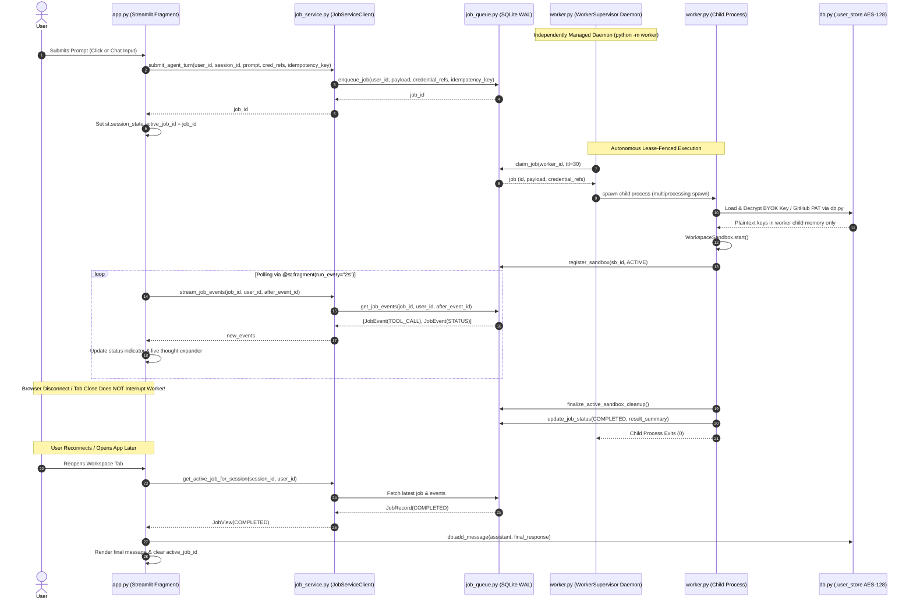
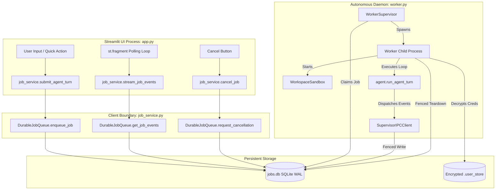
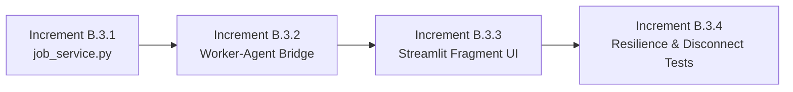

# Phase B.3 Application Integration Architecture Audit & Blueprint (Revised)

**Status:** Architecture Review Revision (Pre-Implementation)  
**Author:** AI Cloud Workspace Agent  
**Base Commit Inspected:** [`e02f52b459a72b33691d3ca954aae9654fd59203`](file:///home/gamp/portfolio/ai-cloud-workspace) (`main` post-PR #3 merge)  
**Branch:** `audit/phase-b3-application-integration`  
**Scope:** Streamlit Application ([`app.py`](file:///home/gamp/portfolio/ai-cloud-workspace/app.py)), Agent Execution ([`agent.py`](file:///home/gamp/portfolio/ai-cloud-workspace/agent.py)), User Store ([`db.py`](file:///home/gamp/portfolio/ai-cloud-workspace/db.py)), Durable Job Store ([`job_queue.py`](file:///home/gamp/portfolio/ai-cloud-workspace/job_queue.py)), and Autonomous Worker Engine ([`worker.py`](file:///home/gamp/portfolio/ai-cloud-workspace/worker.py)).

---

## 1. Executive Summary & Review Revisions

With the successful merge of Phase B.1 (Durable Job Store) and Phase B.2 (Autonomous Worker Engine), the repository possesses an enterprise-grade, lease-fenced, crash-resilient execution substrate. This revision addresses three critical architectural constraints identified during the initial Phase B.3 audit review:

1. **Worker Process Model & Decoupled Lifecycle:** The worker supervisor is **never** started, managed, or owned by the Streamlit application process. The worker supervisor runs strictly as an independent OS service daemon (`python -m worker`). Streamlit acts solely as an unprivileged client interface for job submission, event observation, and cancellation requests.
2. **Credential Reference Architecture:** Plaintext credentials, session decryption context, and master encryption keys are **never** placed into durable job records, event tables, or payload blobs. Payloads store immutable, tenant-scoped *credential references*. The independent worker process decrypts credentials directly from the encrypted user store ([`db.py`](file:///home/gamp/portfolio/ai-cloud-workspace/db.py)) inside worker child memory at execution time, enabling jobs to continue seamlessly after the user's browser session disconnects.
3. **SQLite WAL Deployment Boundary:** SQLite in Write-Ahead Logging (WAL) mode is verified and explicitly bounded to **coordinated processes running on the same host and local POSIX filesystem**. Multi-container or multi-host deployments sharing SQLite over network filesystems (NFS/CIFS) are explicitly out-of-scope for Phase B.3.

---

## 2. Verified Current Behavior vs. Proposed Phase B.3 Architecture

### 2.1 Verified Current Behavior (`main` at `e02f52b`)

Source code inspection of [`app.py`](file:///home/gamp/portfolio/ai-cloud-workspace/app.py), [`agent.py`](file:///home/gamp/portfolio/ai-cloud-workspace/agent.py), and [`db.py`](file:///home/gamp/portfolio/ai-cloud-workspace/db.py) confirms the following runtime dynamics:

1. **Agent Initiation & Execution Flow ([`app.py:1654-1740`](file:///home/gamp/portfolio/ai-cloud-workspace/app.py#L1654-L1740)):**
   - User prompt is captured in Streamlit's script runner thread.
   - `app.py` directly instantiates `sandbox = WorkspaceSandbox(repo_name, github_token)` and calls `sandbox.start()` synchronously.
   - It invokes `agent.run_agent_turn()` on the active Streamlit script runner thread with a blocking loop up to `max_turns`.
   - UI status updates are executed synchronously via `status_box.update(label=text)`.
2. **Streamlit Script Reruns & UI Interactions:**
   - Any widget interaction (sidebar filters, tab clicks) triggers a script rerun.
   - In Streamlit, a rerun starts a new execution of `app.py`. If a previous script run was active on that session, Streamlit halts or abandons the previous script run's output widgets.
   - Crucially, in Python, a thread running CPU work or blocking socket I/O may continue executing in the background until it finishes or errors, but its UI callbacks fail or detach, leaving the thread's results unpersisted to the UI.
3. **Sandbox Teardown & Inability to Survive Disconnects:**
   - [`app.py:1737-1740`](file:///home/gamp/portfolio/ai-cloud-workspace/app.py#L1737-L1740) wraps execution in `try ... finally: sandbox.close()`.
   - If the user closes the tab or navigates away before completion, the sandbox is abruptly torn down (or worse, if the thread is terminated by a server shutdown, the container leaks on the host without cleanup).
   - The sandbox **cannot** survive independently of the UI session under the current design.
4. **Result Persistence & Reconnection Failure:**
   - Final results and terminal output are only written to the database via `db.add_message()` at [`app.py:1729-1736`](file:///home/gamp/portfolio/ai-cloud-workspace/app.py#L1729-L1736) *after* the entire synchronous turn finishes.
   - If a user disconnects or refreshes mid-turn, nothing is written to `db.add_message()`. Upon reconnecting, the user sees an empty chat without intermediate history or recovered output.
5. **Cancellation Disconnect:**
   - [`app.py`](file:///home/gamp/portfolio/ai-cloud-workspace/app.py) provides no cancellation mechanism for running turns. Even if a user clicks another action, the running agent turn cannot be stopped cooperatively.

---

### 2.2 Proposed Phase B.3 Execution Architecture

In Phase B.3, execution is fully decoupled into three isolated tiers:
- **Presentation Layer ([`app.py`](file:///home/gamp/portfolio/ai-cloud-workspace/app.py)):** Stateless, reactive Streamlit UI using `@st.fragment(run_every="2s")` to poll and render progress.
- **Service Boundary ([`job_service.py`](file:///home/gamp/portfolio/ai-cloud-workspace/job_service.py)):** High-level client API enforcing tenant boundaries, idempotency, event queries, and cancellation requests.
- **Autonomous Execution Engine ([`worker.py`](file:///home/gamp/portfolio/ai-cloud-workspace/worker.py) & [`job_queue.py`](file:///home/gamp/portfolio/ai-cloud-workspace/job_queue.py)):** Dedicated background daemon process (`WorkerSupervisor`) supervising child workers (`run_worker_process`) with lease heartbeats, sandbox registration, side-effect ledger, and atomic crash recovery.



---

## 3. Detailed Architecture Specifications

### 3.1 Worker Process Ownership & Lifecycle

**Decision:** The worker supervisor (`WorkerSupervisor`) is an independently managed OS process. It is **never** launched by or embedded within the Streamlit web server.

1. **Development Environment:**
   - Started explicitly in terminal or background process: `python -m worker --daemon` or `python worker.py`.
   - Streamlit connects to the shared SQLite WAL database using the path in `JOBS_DB_PATH` or `DEFAULT_DB_PATH`.
   - If the worker daemon is not running when a job is enqueued, the job remains safely in `QUEUED` status; `app.py` displays a clear status banner: *"Job queued. Waiting for worker daemon..."*.
2. **Production Environment:**
   - Managed as an independent systemd unit, container, or supervisor service (e.g., `supervisord` / systemd unit `ai-cloud-worker.service`).
   - Independent restart policies and log rotation.
3. **Prevention of Duplicate Supervisors:**
   - The supervisor enforces an exclusive flock lock on the database/pidfile directory (`~/.ai_cloud_workspace/worker_supervisor.lock`).
   - If an operator or script attempts to start a second supervisor instance, it fails immediately with an error log: `"Another WorkerSupervisor is already active. Exiting."`.
4. **Shutdown & Failure Recovery:**
   - Clean shutdown (SIGTERM/SIGINT): Supervisor notifies worker child processes, waits up to 10s for cooperative termination, cleans up child slots, closes IPC server, and releases locks.
   - Sudden supervisor crash (SIGKILL/power loss): The next supervisor instance that starts runs the reconciler:
     - Scans expired leases (`lease_expires_at < now`).
     - Reclaims active sandboxes via `orphan_cleanup_status`.
     - Re-enqueues or fails timed-out jobs safely according to retry policy.

---

### 3.2 Credential Reference Architecture & Post-Session Autonomy

**Decision:** Plaintext credentials and master encryption keys are strictly decoupled from the durable job queue. Durable job payloads store only scoped *credential references*.

1. **Storage & Separation of Concerns:**
   - **Encrypted Store ([`db.py`](file:///home/gamp/portfolio/ai-cloud-workspace/db.py)):** Sensitive BYOK API keys and GitHub PATs are encrypted with AES-128 Fernet and persisted in `.user_store/<sha256(user_id)>.json` or Supabase encrypted tables.
   - **Job Payload (`durable_jobs.payload`):** Contains user instructions, repository name, target branch, model name, and `credential_refs`:
     ```json
     {
       "credential_refs": {
         "github": {"type": "user_store", "account_id": "gh_1730700000_octocat"},
         "gemini": {"type": "user_store", "provider": "gemini"}
       }
     }
     ```
   - No plaintext API keys, GitHub tokens, or session tokens exist in `durable_jobs` or `job_events`.
2. **Worker-Side Credential Retrieval:**
   - The worker child process is an OS process executing under the same host security context with access to `ENCRYPTION_KEY` (via environment variable or secret configuration).
   - Upon claiming a job, the worker executes `execute_job_in_worker()`:
     1. Reads `user_id` from the claimed job.
     2. Invokes `db._load_local_user_data(user_id=user_id)` inside the worker child process.
     3. Resolves and decrypts the referenced keys directly into private worker child process memory.
     4. Passes decrypted strings in-memory to [`WorkspaceSandbox`](file:///home/gamp/portfolio/ai-cloud-workspace/sandbox.py) and [`agent.run_agent_turn()`](file:///home/gamp/portfolio/ai-cloud-workspace/agent.py).
3. **Post-Session Validity:**
   - Because the worker resolves credentials from the persistent encrypted user store on disk using `ENCRYPTION_KEY`, the job does **not** depend on an active Streamlit HTTP session, cookie, or PKCE OAuth token.
   - If the user closes the browser or powers down their client machine, the worker process continues running autonomously until the turn completes.
4. **Tenant Ownership & Authorization Checks:**
   - The worker verifies that the `user_id` on the job record matches the owner of the credentials retrieved.
   - If a credential reference cannot be found or decrypted, the worker immediately fails closed (`JobQueueError("Security violation: required credential reference could not be resolved from secure tenant store.")`) and transitions the job to `FAILED`.

---

### 3.3 SQLite WAL Supported Deployment Boundary

**Decision:** SQLite Write-Ahead Logging (WAL) is supported strictly for **same-host, multi-process deployments sharing a local POSIX filesystem**.

1. **Supported Deployment Model:**
   - Streamlit web application process and Worker supervisor daemon run on the **same OS host** (or within the same host filesystem mount).
   - The SQLite database file (`jobs.db`) is configured with:
     ```sql
     PRAGMA journal_mode = WAL;
     PRAGMA synchronous = NORMAL;
     PRAGMA busy_timeout = 30000;
     ```
   - Multiple reader processes (Streamlit script runners) and writer processes (`WorkerSupervisor` and child workers) coordinate concurrently via POSIX advisory locks (`fcntl`) and SQLite's internal shared-memory (`jobs.db-shm`) / WAL (`jobs.db-wal`) files.
2. **Unsupported Architectures & Explicit Limitations:**
   - **Network Filesystems (NFS, CIFS, SMB, GlusterFS):** WAL mode requires shared memory primitives (`mmap` on the `-shm` file) and reliable POSIX byte-range locking. Distributed network filesystems have broken or buggy `fcntl`/`mmap` cache coherence, leading to database corruption.
   - **Cross-Host Containers:** Separate Docker containers running on different virtual machines or cloud nodes **must not** attempt to mount a shared SQLite WAL database over network storage.
3. **Future Scaling Path (Beyond Phase B.3):**
   - If multi-host distributed scaling is required in the future, the storage layer must be migrated to a client-server relational database (e.g., PostgreSQL with `SKIP LOCKED` row claiming). No database migration is performed in Phase B.3.

---

### 3.4 Validated Streamlit Behavior & UI Reactivity

1. **Environment Verification:**
   - Python virtual environment: `.venv/bin/python3` (Python 3.12.3).
   - Pytest version: `pytest 9.2.0`.
   - Pinned Streamlit dependency in `requirements.txt`: `streamlit>=1.65.0`.
   - **Installed Streamlit version:** `streamlit 1.65.0`.
   - **Feature Availability:** `hasattr(st, 'fragment') == True`.
   - Signature: `st.fragment(func=None, *, run_every=None, parallel=False, key=None)`.
2. **Flicker-Free Polling Implementation:**
   - In Streamlit 1.65.0, `@st.fragment(run_every="2s")` allows a specific UI function to rerun periodically on a background interval *without* re-executing the entire page script.
   - The main script loads chat history once. The active job progress bar, status spinner, and streaming thought log are isolated inside the fragment.
   - When the fragment observes `job.status in ("COMPLETED", "FAILED", "CANCELLED")`, it persists the final result via `db.add_message()`, clears `st.session_state.active_job_id`, and triggers `st.rerun()` to return the UI to idle state.
3. **Reconnection & Hydration Logic:**
   - On page load, `app.py` queries `job_service.get_active_job_for_session(session_id, user.id)`.
   - If an active job exists (`QUEUED` or `RUNNING`), `st.session_state.active_job_id` is restored, and the `@st.fragment` resumes polling from the last received event ID (`after_event_id`).
   - If a job finished while the user was away, the UI fetches the final status, appends the assistant response to the conversation history, and renders the completed chat state.

---

## 4. Application-to-Worker Call Graph

### 4.1 Component Interaction Overview



---

## 5. Security & Isolation Matrix

| Threat Vector | Risk Level | Architectural Mitigation |
| :--- | :--- | :--- |
| **Plaintext Credential Exposure** | Critical | Plaintext keys are **never** passed in job payloads or logs. Payloads hold references (`credential_refs`); worker child process decrypts them in-memory only via `db._load_local_user_data()` and `ENCRYPTION_KEY`. |
| **Cross-Tenant Data Tampering** | Critical | All service methods (`submit_agent_turn`, `stream_job_events`, `cancel_job`, `get_job_status`) require and enforce `user_id`. SQL queries in `job_queue.py` strictly enforce `WHERE user_id = ?`. |
| **Orphaned Sandbox Container Leaks** | High | Worker registers container ID upon creation (`register_sandbox`). On normal completion, worker executes `finalize_active_sandbox_cleanup()`. On abnormal crash, supervisor background reconciler destroys orphaned container. |
| **Race Conditions on Cancellation** | Medium | Cancellation is cooperatively checked by the worker watchdog thread every 5s. Side-effect creation (e.g. GitHub PR) requires atomic IPC lease verification before execution. |
| **Database Lock Contention** | Medium | SQLite WAL mode with `busy_timeout=30000ms`. Writes use short-lived `BEGIN IMMEDIATE` transactions under `queue._lock`. UI read queries do not block worker writes. |

---

## 6. Incremental Implementation Plan & Acceptance Criteria

To ensure strict regression testing and verifiable boundaries, Phase B.3 will be implemented across four distinct increments:



### Increment B.3.1: Service Layer (`job_service.py`)
- **Scope:** Create `job_service.py` introducing `JobServiceClient` and `JobView`.
- **Implementation:**
  - Wrap `DurableJobQueue` with sanitized methods.
  - Compute deterministic `idempotency_key` based on `sha256(session_id:user_id:user_turn:prompt)`.
  - Validate tenant isolation on all reads and cancellations.
- **Acceptance Criteria:**
  - `tests/test_phase_b3_job_service.py` passes 100%.
  - Verified rejection of cross-tenant job queries.
  - Verified deduplication of rapid duplicate submissions.

### Increment B.3.2: Worker-to-Agent Execution Bridge
- **Scope:** Update `worker.py` to route `job_type="AGENT_RUN"` to `agent.run_agent_turn()`.
- **Implementation:**
  - Adapt status callbacks from `agent.py` to dispatch structured `JobEvent` records via IPC or direct queue event logging.
  - Bind `ExecutionController` abort flag to agent step loop.
  - Verify credential resolution from `credential_refs` with fail-closed semantics.
- **Acceptance Criteria:**
  - Worker executes end-to-end agent turn in isolated process.
  - Sandbox registered and transitioned to `CLEANED` on completion.
  - Side effects (PR creation) correctly fenced and recorded.

### Increment B.3.3: Streamlit UI Integration (`app.py`)
- **Scope:** Refactor chat input and execution rendering in [`app.py`](file:///home/gamp/portfolio/ai-cloud-workspace/app.py).
- **Implementation:**
  - Replace blocking `agent.run_agent_turn()` call with `job_service.submit_agent_turn()`.
  - Implement `@st.fragment(run_every="2s")` to poll and render active job status, tool execution, and thinking logs.
  - Add explicit "Cancel Run" button in the active status box.
  - Implement session rehydration on page reload.
- **Acceptance Criteria:**
  - Prompt submission returns control to UI immediately.
  - Live progress updates render without whole-page flicker.
  - Chat history updates correctly upon completion.

### Increment B.3.4: Reconnection, Cancellation, & Disconnect Resilience
- **Scope:** Comprehensive end-to-end integration tests (`tests/test_phase_b3_integration.py`).
- **Implementation:**
  - Test simulated browser disconnect: submit job, disconnect client, verify worker completes and records results in job queue.
  - Test reconnection: reconnect client after completion, verify UI retrieves and renders assistant message.
  - Test cooperative cancellation: trigger cancellation while worker is running, verify worker terminates and sandbox is cleaned up.
  - Test worker daemon failure: verify queued jobs survive and resume when daemon restarts.
- **Acceptance Criteria:**
  - All Phase A, B.1, B.2, and B.3 tests pass (100% green).
  - Clean working tree with zero container leaks.

---

## 7. Status & Next Step

* **Audit Branch:** `audit/phase-b3-application-integration`
* **Audit Document:** [`docs/phase_b3_application_integration_audit.md`](file:///home/gamp/portfolio/ai-cloud-workspace/docs/phase_b3_application_integration_audit.md)
* **Code State:** Frozen. Zero changes to `main`, Phase A, B.1, or B.2. No implementation of B.3 has begun.
* **Awaiting:** User review and authorization to proceed with Increment B.3.1.
