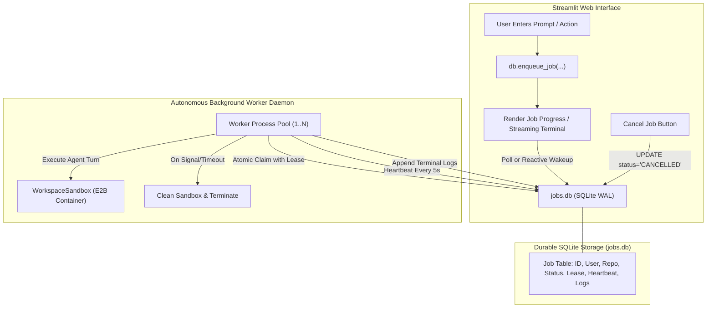
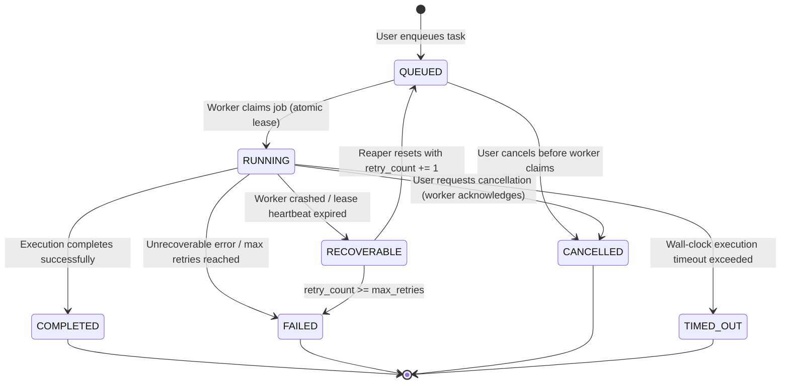

# Phase B — Durable Execution: Architecture Audit & Engineering Plan

**Repository:** `laxjovial/ai-cloud-workspace`  
**Working Branch:** `feat/phase-b-durable-execution`  
**Baseline Commit:** Phase A Merge Commit [`5147be6c127c3eed87b6cabb0ca24f65b2550fa7`](file:///home/gamp/portfolio/ai-cloud-workspace/docs/phase_a_consolidated_review.md)  
**Security Posture:** All Phase A security boundaries (OAuth PKCE session binding, fail-closed encryption, ASKPASS isolation, path confinement, truthful outcomes) are preserved and non-negotiable.

---

## 1. Stage 1: Architectural Audit of the Existing Execution Engine

An exhaustive trace through [`app.py`](file:///home/gamp/portfolio/ai-cloud-workspace/app.py), [`agent.py`](file:///home/gamp/portfolio/ai-cloud-workspace/agent.py), [`sandbox.py`](file:///home/gamp/portfolio/ai-cloud-workspace/sandbox.py), and [`db.py`](file:///home/gamp/portfolio/ai-cloud-workspace/db.py) reveals the following concrete implementation mechanics:

### 1.1 How User Requests Become Execution Tasks
- In [`app.py#L1622-L1628`](file:///home/gamp/portfolio/ai-cloud-workspace/app.py#L1622-L1628), user requests enter through `st.chat_input` or four shortcut buttons (`Audit Codebase`, `Run Test Suite`, `Start Web Preview`, `Check Git Diffs`).
- There is **no job record or queue**. When a prompt is submitted, the code immediately enters an in-process, synchronous block within the Streamlit script execution thread ([`app.py#L1654-L1740`](file:///home/gamp/portfolio/ai-cloud-workspace/app.py#L1654-L1740)).

### 1.2 Impact of Streamlit Callbacks and Reruns
- The entire agent execution loop ([`agent.run_agent_turn`](file:///home/gamp/portfolio/ai-cloud-workspace/agent.py#L133)) runs directly inside Streamlit's reactive render cycle (`render_workspace()`).
- If the user interacts with any UI widget, triggers a page refresh, or if Streamlit issues a rerun (`st.rerun()`), the Python thread executing the turn is abruptly interrupted or rerun from the top.
- Any in-flight LLM calls or sandbox commands are either orphaned or aborted mid-execution.

### 1.3 Tool Invocation Mechanism
- The agent loop in [`agent.py#L150-L290`](file:///home/gamp/portfolio/ai-cloud-workspace/agent.py#L150-L290) calls LiteLLM's `completion()` in a synchronous loop up to `max_steps=10`.
- Tool calls returned by the model (`run_terminal_command`, `start_dev_server`, `read_file`, `write_file`, `create_pull_request`) are executed sequentially by direct method calls on the provided `WorkspaceSandbox` instance in the same process.

### 1.4 E2B Sandbox Lifecycle: Creation, Reuse, and Destruction
- In [`app.py#L1660-L1668`](file:///home/gamp/portfolio/ai-cloud-workspace/app.py#L1660-L1668), a new `WorkspaceSandbox` is instantiated and booted via `sandbox.start()` for **every single prompt submitted**:
  ```python
  sandbox = WorkspaceSandbox(repo_name=st.session_state.active_repo, github_token=active_gh_token)
  boot_res = sandbox.start() # Creates cloud container, clones repo
  ```
- **No reuse**: Sandboxes are not pooled or reused across turns.
- In [`app.py#L1737-L1740`](file:///home/gamp/portfolio/ai-cloud-workspace/app.py#L1737-L1740), `sandbox.close()` is invoked in a `finally` block unless `"Preview URL: https://"` is present in `terminal_logs`. If a preview URL was created, the container is left running in the cloud with no persistent reference saved anywhere to clean it up later.

### 1.5 Execution Mechanism (Threads, Async, Subprocesses)
- Execution is **100% synchronous and single-threaded** on the Streamlit session thread.
- There are no background worker processes, no thread pools, and no async event loops managing execution.

### 1.6 State Storage & Survivability Across Restarts
- Messages are saved to Supabase/local encrypted JSON *only after* the full execution completes ([`app.py#L1729-L1736`](file:///home/gamp/portfolio/ai-cloud-workspace/app.py#L1729-L1736)).
- While executing, state lives strictly in Python local variables (`accumulated_logs`, `working_messages`, `status_box`).
- **Zero survivability**: If the server restarts, crashes, or the process terminates during execution, all intermediate progress, logs, and outputs are permanently lost.

### 1.7 Cancellation, Timeouts, Retries, and Error Handling
- **Cancellation**: There is no cancellation token, cancel button, or interrupt handler. Once started, execution monopolizes the session until `max_steps` is exhausted or an error is raised.
- **Timeouts**: No wall-clock timeout wraps `run_agent_turn` or `sandbox.run_command`. A hanging bash command or unresponsive dev server blocks the thread indefinitely (subject only to E2B client timeouts).
- **Retries**: There is a narrow retry for LLM `reasoning_effort` argument incompatibility ([`agent.py#L176-L186`](file:///home/gamp/portfolio/ai-cloud-workspace/agent.py#L176-L186)), but no retry mechanism for network drops, sandbox disconnects, or crashed commands.

### 1.8 Genuine Concurrency
- Multiple simultaneous tasks cannot be run. A user can only execute one prompt at a time per session. If multiple users execute commands simultaneously, they run as independent Streamlit session threads inside the same Python process, contending for GIL and network I/O.

### 1.9 Multi-Tenant Isolation
- In-memory execution objects are tied to the Streamlit session.
- Stored data is partitioned by `user_id` in Supabase and local encrypted directories (`.user_store/<safe_user_id>.json`).
- However, since E2B sandbox instances and background dev servers are not tracked in a centralized persistent registry, orphaned containers in the E2B account have no tenant ownership metadata attached.

### 1.10 Impact of Browser Disconnects, Streamlit Restarts, and Crashes
- If the user's browser closes or WebSocket drops: Streamlit marks the session inactive; if closed before turn completion, the thread terminates or its output cannot be delivered.
- If the Streamlit process restarts: The entire turn is lost; the user returns to see only the prompt they typed with no response and no logs.
- If a container crashes: `agent.py` receives an unhandled exception or non-zero exit code without recovery options.

---

## 2. Stage 2: Architecture for Durable Background Execution

To solve these 10 failure points without introducing heavy external infrastructure (such as Redis, Celery, RabbitMQ, or Kubernetes), we propose a **Local-First SQLite WAL Durable Job Queue & Autonomous Subprocess Worker Pool**.

### 2.1 Storage & Queue Engine: SQLite with Write-Ahead Logging (WAL)
- **Why SQLite WAL?**
  - Zero external daemons: No Redis or Celery dependencies required; runs natively on Linux, macOS, and containers.
  - ACID guarantees: SQLite in `WAL` mode (`PRAGMA journal_mode=WAL; PRAGMA busy_timeout=5000;`) supports multiple concurrent readers alongside a serialized writer. Writers are serialized at the database level via explicit `BEGIN IMMEDIATE` transactions (SQLite does not provide row-level writer locks). Write transactions remain short and never encompass LLM or sandbox operations.
  - Perfect fit for hybrid architecture: Mirrors the application's existing fail-closed local storage philosophy while optionally replicating terminal states to Supabase.

### 2.2 Core Components



1. **Job Queue Manager (`job_queue.py`)**:
   - Manages SQLite schema, migrations, job submissions, atomic leases, heartbeats, cancellations, and log streaming.
2. **Background Worker Engine (`worker.py`)**:
   - A standalone daemon or managed multi-process worker pool (`multiprocessing` / detached process) that operates independently of Streamlit.
   - Constantly claims `QUEUED` jobs, executes `agent.run_agent_turn`, flushes logs incrementally, and manages sandbox lifecycles.
3. **Streamlit UI Integration**:
   - Submitting a prompt inserts a `QUEUED` job and immediately frees the Streamlit render thread.
   - The UI displays an active execution card showing job status (`QUEUED`, `RUNNING`), streaming logs, a **Cancel** button, and elapsed time.
   - If the browser closes, refreshes, or reconnects, the job continues uninterrupted in the background worker.

---

## 3. Stage 3: Lifecycle States and Failure Semantics



### 3.1 State Transition Invariants
- **Atomic Claiming**:
  `UPDATE jobs SET status='RUNNING', worker_id=?, lease_expires_at=? WHERE id=? AND status='QUEUED'` (enforced inside `BEGIN IMMEDIATE` transaction). Exactly one worker can claim a job.
- **Heartbeat & Lease**:
  Running workers update `heartbeat_at = now()` and `lease_expires_at = now() + lease_duration` every 5 seconds.
- **Dead-Worker Reaper**:
  If a worker process crashes (SIGKILL, segfault, power loss), its heartbeat stops. The reaper detects `status='RUNNING' AND lease_expires_at < now()`.
  - **Cancellation Precedence**: If `cancel_requested_at` is set on the expired running job, it is **never re-queued**; it transitions directly to terminal `CANCELLED`.
  - If cancellation was not requested and `retry_count < max_retries`, transitions to `QUEUED` with incremented `lease_generation` (fencing out the dead worker) and `retry_count += 1`.
  - If `retry_count >= max_retries`, transitions to terminal `FAILED` with explicit error: `"Worker crashed or lost heartbeat during execution."`
- **Cancellation**:
  When a user requests cancellation, `cancel_requested_at` is durably set. For queued jobs, status is immediately updated to `CANCELLED`. For running jobs, user cancellation takes strict precedence over normal completion. A worker acknowledging cancellation terminates its tools, cleans up its sandbox, and records `CANCELLED`. If a worker reports `FAILED` or `TIMED_OUT` while cancellation was pending, cancellation precedence applies: status transitions to `CANCELLED` while preserving the failure diagnostic error in `error_json`.
- **Wall-Clock Timeouts**:
  Jobs specify `timeout_seconds` (default: 600s / 10m). If exceeded, worker forces sandbox termination and marks status `TIMED_OUT`.

---

## 4. Stage 4: Required Verification & Test Plan

A dedicated test suite `tests/test_phase_b_durable_execution.py` will be developed with full test fixtures:

1. **Browser Disconnect Survival**: Simulate job enqueue, disconnect UI context, verify worker continues execution to `COMPLETED`.
2. **Streamlit Rerun Independence**: Trigger multiple simulated Streamlit rerun cycles; verify active job lease and log stream remain unaffected.
3. **Atomic Multi-Worker Claiming**: Launch 5 concurrent workers racing to claim 5 queued jobs; verify each job is claimed by exactly one worker with zero double-claims.
4. **Crash Recovery & Lease Expiration**: Launch a job, simulate worker kill (`SIGKILL`), verify reaper detects expired lease and safely re-queues or fails closed.
5. **Heartbeat Protection**: Verify healthy worker refreshing heartbeats prevents active jobs from being reclaimed by the reaper.
6. **Cooperative & Forced Cancellation**: Verify user cancellation stops tool execution and tears down the cloud container promptly.
7. **Execution Timeout Enforcement**: Verify a task hanging on an infinite command is halted at `timeout_seconds` and marked `TIMED_OUT`.
8. **Multi-Tenant Job Isolation**: Verify User A cannot query, cancel, or view logs for User B's jobs.
9. **Sandbox Resource Cleanup Guarantee**: Verify `WorkspaceSandbox.close()` is guaranteed to execute upon completion, cancellation, timeout, and failure.
10. **Truthful Outcome Persistence**: Verify exit codes, logs, and error traces are durably written to SQLite before job is marked `COMPLETED` or `FAILED`.

---

## 5. Implementation Roadmap & Milestones

1. **Phase B.1: Durable Job Store & SQLite Queue Engine (`job_queue.py`)**
   - SQLite schema with WAL mode, indices on `(status, lease_expires_at)` and `(user_id, created_at)`.
   - Thread-safe & multi-process safe atomic lease queries.
2. **Phase B.2: Autonomous Worker Daemon (`worker.py`)**
   - Background worker process with heartbeat loop, step-by-step cancellation checking, timeout watchdogs, and sandbox cleanup `finally` blocks.
   - Reaper process for stale lease reclamation.
3. **Phase B.3: Streamlit UI Integration (`app.py`)**
   - Non-blocking job submission.
   - Real-time job status component with auto-polling log viewer and Cancel button.
4. **Phase B.4: Comprehensive Verification (`tests/test_phase_b_durable_execution.py`)**
   - Integration tests covering all 10 verification scenarios.
